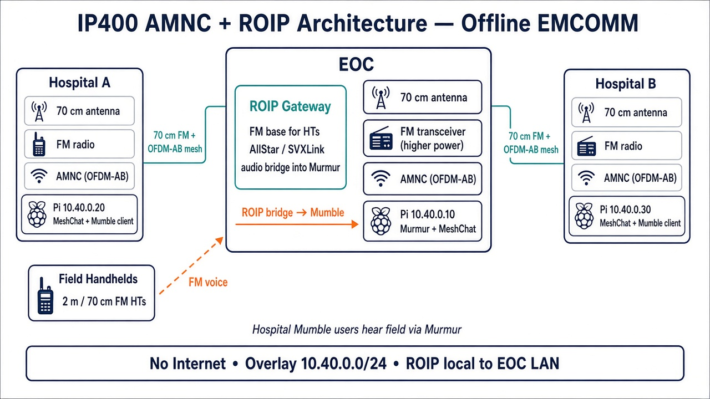
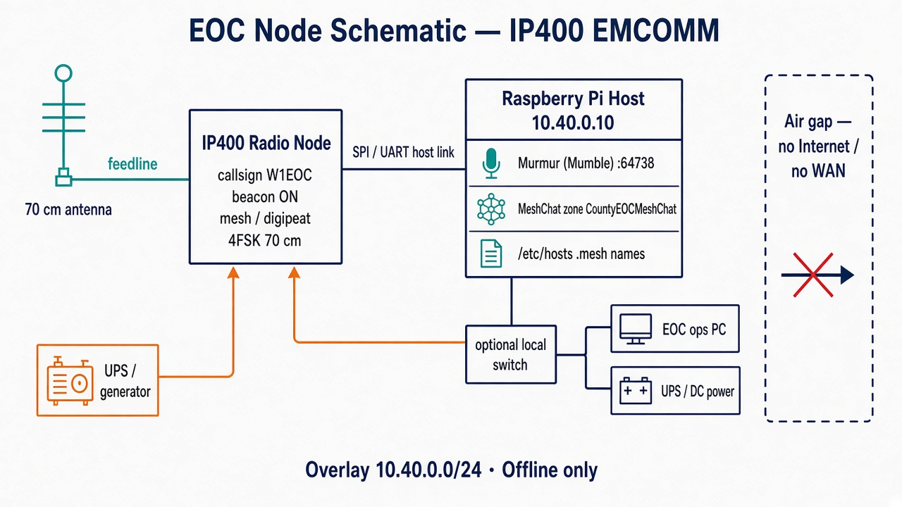

# 400 MHz Mesh Network

Offline EMCOMM mesh design for a local **EOC** and **two hospitals** on the amateur **70 cm / ~400 MHz** band. No Internet dependency.

## Current baseline: IP400 AMNC + ROIP

| Layer | Role |
| --- | --- |
| **AMNC + FM transceiver** | IP400 OFDM-AB mesh modem using a higher-power FM radio at each fixed site |
| **Host Pi** | Overlay `10.40.0.0/24` — Murmur (Mumble) + MeshChat |
| **ROIP at EOC** | Field FM handhelds bridged into Murmur (AllStar / SVXLink) |
| **Field HTs** | Analog FM tactical voice (separate channel from mesh RF) |

### Architecture diagram

### EOC node schematic

### Overlay addresses (air-gapped)

| IP | Role |
| --- | --- |
| `10.40.0.10` | EOC Pi — Murmur + MeshChat |
| `10.40.0.20` | Hospital A — MeshChat + Mumble client |
| `10.40.0.30` | Hospital B — MeshChat + Mumble client |

**Field → Mumble path:** HT (FM) → EOC base → ROIP → Murmur → IP400 mesh → hospital Mumble clients.

Use a **dedicated FM channel** for ROIP; keep it off the AMNC mesh frequency. No WAN, public DNS, or cloud services in operations.

## Design docs (Cursor canvases)

Source canvases used while designing the system:

| File | Topic |
| --- | --- |
| [docs/canvases/emcomm-ip400-mesh.canvas.tsx](docs/canvases/emcomm-ip400-mesh.canvas.tsx) | IP400 architecture |
| [docs/canvases/emcomm-ip400-deploy-kit.canvas.tsx](docs/canvases/emcomm-ip400-deploy-kit.canvas.tsx) | IP map, Murmur caps, site checklists |
| [docs/canvases/emcomm-70cm-npr-ip.canvas.tsx](docs/canvases/emcomm-70cm-npr-ip.canvas.tsx) | NPR alternative (star topology) |
| [docs/canvases/emcomm-70cm-fm-only.canvas.tsx](docs/canvases/emcomm-70cm-fm-only.canvas.tsx) | FM-only (no IP apps over RF) |
| [docs/canvases/emcomm-2m-aredn-mesh.canvas.tsx](docs/canvases/emcomm-2m-aredn-mesh.canvas.tsx) | Earlier hybrid 2 m + AREDN sketch |

Additional diagrams: [docs/diagrams/](docs/diagrams/).

## Compliance notes

- Amateur **Part 97** (or local) rules apply — mode bandwidth, ID, and content limits.
- Keep hospital clinical networks and PHI off this mesh.
- Verify IP400/AMNC hardware availability and legal on-air modes before deployment.

## References

- [IP400 project (ADRCS)](https://ip400.adrcs.org/)
- IP400 OFDM-AB / AMNC documentation on the project site

## License

Documentation and diagrams in this repository are provided for amateur radio EMCOMM planning. Hardware/firmware from ADRCS and other vendors remain under their respective licenses.
