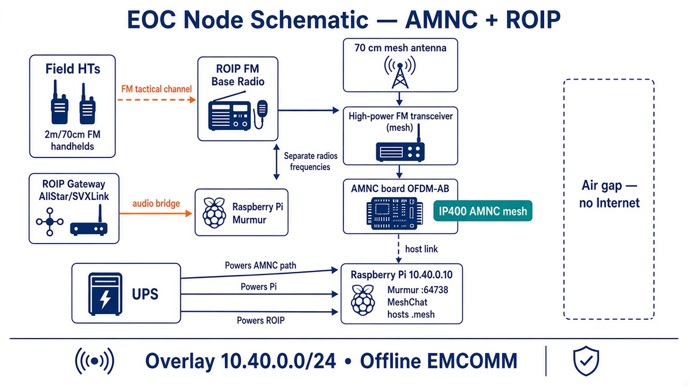

# 400 MHz Mesh Network

Offline EMCOMM mesh for a local **EOC** and **two hospitals** on amateur **70 cm / ~400 MHz**. **No Internet.**

## Baseline architecture: IP400 **AMNC** + **ROIP**

| Layer | Role |
| --- | --- |
| **AMNC + FM transceiver** (each fixed site) | IP400 **OFDM-AB** mesh modem; the FM radio provides RF power/coverage |
| **Host Pi** | Overlay `10.40.0.0/24` — **Murmur (Mumble)** + **MeshChat** |
| **ROIP at EOC** | Field **FM handhelds** → EOC base → AllStar/SVXLink → **bridged into Murmur** |
| **Field HTs** | Analog FM tactical voice on a **separate channel** from the AMNC mesh RF |

### System architecture (AMNC + ROIP)

**Field → Mumble:** HT (FM) → EOC ROIP gateway → Murmur `10.40.0.10` → AMNC/IP400 mesh → hospital Mumble clients.

### EOC node (AMNC + ROIP)

EOC runs **two RF paths**:

1. **Mesh:** antenna → high-power FM transceiver → **AMNC** → Pi (`10.40.0.10`)
2. **ROIP:** field HTs → dedicated FM base → **ROIP gateway** → audio bridge → **Murmur** on the same Pi/LAN

### Overlay addresses (air-gapped)

| IP | Role |
| --- | --- |
| `10.40.0.10` | EOC Pi — Murmur + MeshChat |
| `10.40.0.20` | Hospital A — MeshChat + Mumble client |
| `10.40.0.30` | Hospital B — MeshChat + Mumble client |

No WAN, public DNS, or cloud services in operations.

## Diagrams

| File | Contents |
| --- | --- |
| [ip400-amnc-emcomm-architecture-roip.jpg](docs/diagrams/ip400-amnc-emcomm-architecture-roip.jpg) | **Primary** — full system with **AMNC** + **ROIP** |
| [ip400-eoc-node-schematic-amnc-roip.jpg](docs/diagrams/ip400-eoc-node-schematic-amnc-roip.jpg) | **EOC detail** — AMNC mesh stack + ROIP→Mumble |
| [ip400-amnc-emcomm-architecture.jpg](docs/diagrams/ip400-amnc-emcomm-architecture.jpg) | AMNC sites only (no ROIP) |
| [ip400-emcomm-architecture.jpg](docs/diagrams/ip400-emcomm-architecture.jpg) | Earlier generic IP400 sketch |
| [ip400-eoc-node-schematic.jpg](docs/diagrams/ip400-eoc-node-schematic.jpg) | Earlier EOC sketch (pre-AMNC/ROIP) |

## Design canvases

| File | Topic |
| --- | --- |
| [emcomm-ip400-mesh.canvas.tsx](docs/canvases/emcomm-ip400-mesh.canvas.tsx) | IP400 / AMNC architecture + ROIP notes |
| [emcomm-ip400-deploy-kit.canvas.tsx](docs/canvases/emcomm-ip400-deploy-kit.canvas.tsx) | IP map, Murmur caps, checklists |
| [emcomm-70cm-npr-ip.canvas.tsx](docs/canvases/emcomm-70cm-npr-ip.canvas.tsx) | NPR alternative |
| [emcomm-70cm-fm-only.canvas.tsx](docs/canvases/emcomm-70cm-fm-only.canvas.tsx) | FM-only alternative |
| [emcomm-2m-aredn-mesh.canvas.tsx](docs/canvases/emcomm-2m-aredn-mesh.canvas.tsx) | Earlier 2 m + AREDN sketch |

## Compliance

- Amateur **Part 97** (or local) rules — mode bandwidth, ID, content.
- Keep hospital clinical networks and PHI off this mesh.
- Confirm AMNC availability and legal on-air modes before deploy.

## References

- [IP400 project (ADRCS)](https://ip400.adrcs.org/)
- OFDM-AB / AMNC docs on the project site

## License

Documentation and diagrams are for amateur radio EMCOMM planning. ADRCS and vendor hardware/firmware remain under their licenses.
