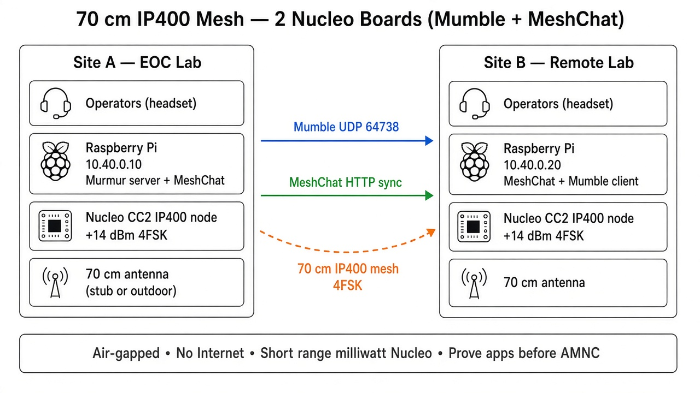
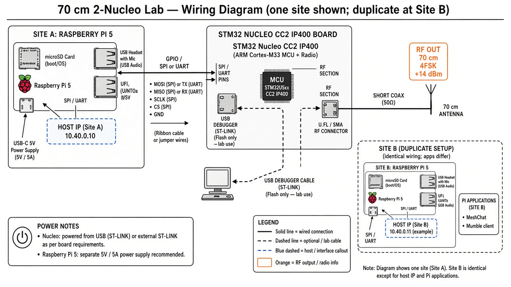

# 70 cm lab mesh — 2× Nucleo + Mumble + MeshChat

Minimal IP400 design to prove offline voice and text before AMNC + high-power FM.

## Architecture diagram



## Wiring diagram (per site)



Duplicate this stack at **Site A** and **Site B**. Only the Pi apps differ (Murmur on A). Exact SPI/UART pin map follows the current ADRCS IP400 Nucleo / UFP guide — do not guess pins from this sketch alone.

| Connection | From | To | Notes |
| --- | --- | --- | --- |
| Host data | Pi GPIO | Nucleo | **SPI** (MOSI/MISO/SCLK/CS + GND) **or** UART (TX/RX + GND) per ADRCS image |
| RF | Nucleo RF connector | 70 cm antenna | U.FL/SMA + short low-loss pigtail; keep coax short |
| Operator audio | USB headset | Pi USB | Mumble mic/speakers; PTT in software |
| Pi power | 5 V PSU (Pi 5: 5 A class) | Pi USB-C | Separate from Nucleo USB if both powered |
| Nucleo power / debug | USB to ST-LINK | Nucleo | Lab flash/console; disconnect debugger WAN PC for air-gap drills |
| Overlay IP | Pi host interface | IP400 stack | `10.40.0.10` (A) / `10.40.0.20` (B) |
| On-air mesh | Antenna A | Antenna B | 70 cm 4FSK; no copper between sites |

```text
[Headset USB]──►[ Raspberry Pi ]──SPI/UART──►[ Nucleo CC2 ]──coax──►[ 70 cm antenna ]
                      │                              │
                 5 V PSU                        USB debug (lab only)
                      │
              Murmur / MeshChat (A)
           or MeshChat + Mumble (B)
```

## Topology

| Site | RF | Host | Services |
| --- | --- | --- | --- |
| **Site A (EOC lab)** | Nucleo CC2 (~+14 dBm, 4FSK) | Pi `10.40.0.10` | **Murmur** + **MeshChat** |
| **Site B (remote lab)** | Nucleo CC2 (~+14 dBm, 4FSK) | Pi `10.40.0.20` | **MeshChat** + **Mumble client** |

```text
Site A:  Operator → Pi (Murmur + MeshChat) → Nucleo → 70 cm antenna
                ↕ IP400 mesh (4FSK)
Site B:  Operator → Pi (MeshChat + Mumble) → Nucleo → 70 cm antenna
```

## Addressing (air-gapped)

| IP | Role |
| --- | --- |
| `10.40.0.0/24` | Lab overlay |
| `10.40.0.10` | Site A — Murmur (`:64738`) + MeshChat |
| `10.40.0.20` | Site B — MeshChat + Mumble client → `10.40.0.10` |

Use matching `/etc/hosts` names (e.g. `mumble.eoc.mesh`, `meshchat.a.mesh`, `meshchat.b.mesh`). No Internet, public DNS, or cloud.

## Stack per site

1. **Nucleo** — IP400 mesh RF / modem (SPI or UART to Pi)  
2. **Pi** — host IP + apps  
3. **Antenna** — 70 cm; outdoor helps, but range stays short at milliwatt TX  

## App settings (lab)

| Service | Setting |
| --- | --- |
| Murmur | `bandwidth=16000` (or lower); Opus; PTT only |
| Mumble clients | Server `10.40.0.10`; one talker at a time |
| MeshChat | Same zone/service name on both Pis |

## Acceptance checks

1. Both callsigns appear in each mesh table  
2. Ping `10.40.0.10` ↔ `10.40.0.20`  
3. Mumble PTT from B heard at A (and reverse)  
4. MeshChat message from each site visible on both  
5. WAN unplugged — all of the above still work  

## Limits

- **Short RF range** (~25 mW class) — room / building / short LOS only  
- Two nodes = link + mesh table; digipeat value needs a third node  
- Not a hospital-distance deploy — use **AMNC + FM** for that (see main BOM)

## Related

- [recommended-fm-radios.md](recommended-fm-radios.md) — later AMNC path  
- [bom-amnc-mumble-emcomm.md](bom-amnc-mumble-emcomm.md) — full three-site program  
- [ip400.adrcs.org](https://ip400.adrcs.org/) — Nucleo / UFP docs  
