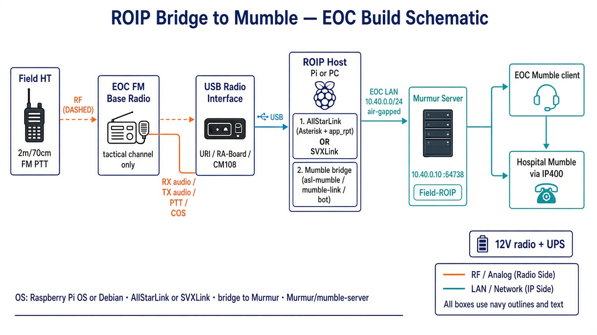

# ROIP Bridge to Mumble (EOC)

How field **FM handhelds** talk to **Mumble** users on the air-gapped mesh. The ROIP bridge sits on the **EOC LAN** next to Murmur (`10.40.0.10`). It does **not** use the AMNC mesh frequency.

## Schematic



## Signal path

```text
Field HT (FM PTT)
    → RF (tactical 2 m / 70 cm channel)
EOC FM base radio
    → RX/TX audio + PTT/COS
USB radio interface (URI / RA-Board / CM108 class)
    → USB
ROIP host (Pi/PC): AllStarLink or SVXLink + Mumble bridge
    → EOC LAN 10.40.0.0/24 (no Internet)
Murmur 10.40.0.10 :64738  channel Field-ROIP
    → Mumble clients at EOC and hospitals (hospitals via IP400/AMNC)
```

## Hardware bill of materials

| Item | Role |
| --- | --- |
| FM base/mobile | Dedicated tactical channel (not AMNC mesh radio) |
| Antenna / feedline | For that channel |
| USB radio interface | RX audio, TX audio, PTT, COS/COR |
| Pi or small PC | Runs ROIP engine + bridge |
| 12 V supply + UPS | Radio and host |

## Software stack

### Path A (recommended): AllStar → Mumble

| Layer | Software |
| --- | --- |
| OS | Raspberry Pi OS or Debian (pre-staged offline image) |
| ROIP engine | **AllStarLink** (Asterisk + **app_rpt**) |
| Bridge | AllStar↔Mumble bridge (e.g. community **asl-mumble** / equivalent) |
| Server | **Murmur** (`mumble-server`) on `10.40.0.10` |
| Clients | **Mumble** at EOC and hospitals |

### Path B: SVXLink → Mumble

| Layer | Software |
| --- | --- |
| OS | Raspberry Pi OS or Debian |
| ROIP engine | **SVXLink** |
| Bridge | SVXLink module/script or audio bridge into Murmur |
| Server / clients | Same Murmur + Mumble clients |

## Air-gap rules

- No public AllStar / HamVoIP / Internet uplinks
- Bridge only to local Murmur (`10.40.0.10`)
- Use a dedicated Mumble channel (e.g. `Field-ROIP`); do not dump HT noise into Command by default
- Keep ROIP FM frequency separate from AMNC OFDM-AB mesh RF
- Enforce PTT discipline / NCS on the bridged channel

## Acceptance checks

1. HT PTT is heard in Mumble `Field-ROIP` at EOC and both hospitals  
2. Mumble PTT keys the EOC FM base and is heard on HTs  
3. WAN unplugged — bridge still works  
4. AMNC mesh traffic still OK while ROIP is active (separate radio/channel)
